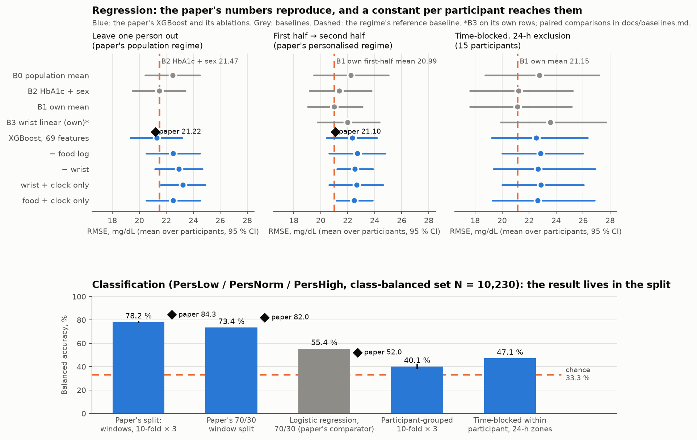

# nir-glucose-reproduction

A reproduction of Bent et al. (2021), *Engineering digital biomarkers of interstitial glucose from noninvasive smartwatches* (npj Digital Medicine 4:89), on the dataset they released, with the baselines the paper did not report and the splits it did not use.

**Result.** **A constant — each participant's mean glucose over the first half of their own record — scores the paper's personalised RMSE to within 0.11 mg/dL (20.99 against 21.10), and the paper's personalised model, rebuilt from its Methods, does not beat it (22.35; 1.36 mg/dL worse, 95 % CI [-0.46, 3.34]).** The population model reproduces to within 0.07 mg/dL (21.29 against 21.22, leave one person out), and its whole advantage over a linear model on HbA1c and sex is 0.19 mg/dL, with a 95 % CI of [-0.63, 1.12] that spans zero. The excursion classifier reaches 78.18 % balanced accuracy under the paper's random-window split (paper: 84.3 %) and 40.15–47.10 % once a participant's windows cannot sit on both sides of a fold, against chance at 33.3 %. Three of the four pre-registered predictions held and P5 was a measurement; the one that failed, P3, failed on reproducing the paper's 84.3 %, not on the drop, which was more than twice the predicted 15 points.



*Top: RMSE mean over participants with the bootstrap 95 % CI; blue, the paper's XGBoost and its ablations; grey, baselines; dashed, the regime's reference baseline; diamond, the paper's number. Bottom: balanced accuracy on the class-balanced set; diamonds, the paper's numbers. Aggregate numbers only; generated by `src/figures.py` from `results/`.*

| Task and regime | Paper | This reproduction | The baseline it has to beat | Model − baseline (paired, 95 % CI) |
|---|---|---|---|---|
| Glucose, RMSE mg/dL — leave one person out (paper's) | 21.22 ± 4.14 | **21.29** ± 4.00 | linear on HbA1c + sex: 21.47 ± 3.94 | -0.19 [-1.12, +0.63]; worse in 10 of 16 |
| Glucose, RMSE — first half → second half (paper's) | 21.10 ± 4.50 | **22.35** ± 3.86 | the participant's first-half mean: 20.99 ± 4.17 | +1.36 [-0.46, +3.34]; worse in 7 of 16 |
| Glucose, RMSE — time-blocked, 24-h zones | — | **22.53** ± 7.21 | the participant's own mean: 21.15 ± 7.44 | +1.38 [-0.71, +3.50]; worse in 9 of 15 |
| Excursion class, balanced accuracy — random windows (paper's) | 84.3 ± 1.3 % | **78.2 %** | chance: 33.3 % | — |
| Excursion class — participant-grouped | — | **40.1 %** | chance: 33.3 % | — |
| Excursion class — time-blocked | — | **47.1 %** | chance: 33.3 % | — |

## The five predictions

Registered in the frozen protocol before any number existed (`docs/protocol.md` §11, D-009) and judged against those words (`results/predictions.csv`):

| Prediction | Statement | Value | Reference | Verdict |
|---|---|---|---|---|
| P1a | B1 under the personalised regime lands within 3 mg/dL of the paper's 21.10 | 20.99 | 21.1 | **held** |
| P1b | the personalised XGBoost beats B1 by less than 3 mg/dL | model 22.35; B1 - model -1.36 [-3.342, 0.464] | 20.99 | **held** |
| P2a | B0 or B2 under LOPO lands within 3 mg/dL of the paper's 21.22 | B0 22.467; B2 21.473 | 21.22 | **held** |
| P2b | the population XGBoost beats B2 by less than 3 | model 21.285; B2 - model 0.188 [-0.633, 1.117] | 21.473 | **held** |
| P3 | classification reproduces within 3 points under R1 (84.3%) and falls by more than 15 points under R2 and R3 | R1 78.18; R2 40.15 (drop 38.03); R3 47.1 (drop 31.08) | 84.3 | **failed** |
| P4 | B1's accuracy (100 - MAPE) is above 84%, from a constant | 86.966 | 84.0 | **held** |
| P5 | measurement: removing the food log costs more RMSE than removing all E4 features | LOPO: minus food +1.215, minus E4 +1.642; halves: minus food +0.368, minus E4 +0.171 | — | **E4 costs more (LOPO); food costs more (halves)** |

## Where the error comes from: the ablations

RMSE in mg/dL, mean over participants (`results/models_summary.csv`; intervals and paired differences in [docs/models.md](docs/models.md)). The two clock features stay in every configuration.

| Features | Leave one person out | First half → second half | Time-blocked |
|---|---|---|---|
| full model, 69 features | 21.29 | 22.35 | 22.53 |
| minus the food log (50) | 22.50 | 22.72 | 22.85 |
| minus sex, HbA1c, ID (66) | 21.39 | 22.27 | 22.43 |
| minus all E4 features (24) | 22.93 | 22.52 | 22.67 |
| E4 features + clock only (47) | 23.22 | 22.65 | 22.87 |
| food log + clock only (21) | 22.50 | 22.48 | 22.63 |
| *Baseline: HbA1c + sex (across) / own mean (within)* | *21.47* | *20.99* | *21.15* |

Every ablated model is worse than the baseline in every regime. Removing the food log costs 1.21 mg/dL across participants and removing all 45 wrist features costs 1.64; within participant the costs are 0.37 and 0.17 (P5).

## How it was done

- **Protocol first.** The paper's claims, inputs, windowing, models, split and metrics were transcribed from the paper, its supplement and the companion DBDP code; the thirteen choices the paper leaves open were resolved and logged (D-008); the protocol was verified against the paper and frozen by hash (`7860469db2e059bd`, pinned by a test) before any fit. [docs/protocol.md](docs/protocol.md)
- **The 69 features** of Supplementary Table 1 as pure functions with hand-computed tests and two leakage guards: perturbing everything from the target time onward changes no feature, and no feature reads a glucose value. **28,964** of 36,898 readings have a usable five-minute epoch; all 69 features are present on **25,644**, against the paper's "over 25,000". [docs/features.md](docs/features.md), [docs/data-layer.md](docs/data-layer.md)
- **Baselines before models:** population mean, per-participant mean, HbA1c-and-sex linear, and a per-participant wrist-only linear model, under every regime, before any XGBoost existed. [docs/baselines.md](docs/baselines.md)
- **The paper's models** — XGBoost for glucose, a decision tree with in-fold recursive feature elimination for the excursion classes — with the paper's hyperparameters, one seed, nothing tuned. [docs/models.md](docs/models.md), [docs/classification.md](docs/classification.md)
- **Three split regimes side by side:** the paper's; participant-grouped; time-blocked within participant with 24-hour exclusion zones on both sides of the boundary.
- **The write-up:** what replicated, what did not, and what data would settle it. [docs/reproduction.md](docs/reproduction.md). Every decision, with its evidence: [docs/decisions.md](docs/decisions.md).

## The data

BIG IDEAs Lab Glycemic Variability and Wearable Device Data, PhysioNet v1.1.3 ([data/README.md](data/README.md)): 16 participants with HbA1c 5.3–6.4 %, wearing an Empatica E4 with a Dexcom G6 every five minutes and a food log, 8–10 days each. Every file is verified against the dataset's checksum list before it is read. Open Data Commons Attribution licence; this repository's own policy keeps every raw file, cache and per-participant trace out of the tree regardless.

## Reproduce

```bash
python -m venv .venv && source .venv/bin/activate
pip install -r requirements.txt
pre-commit install && pre-commit install --hook-type pre-push
pytest                              # 169 tests; 17 need the dataset and skip without it
python -m src.data.coverage         # results/coverage.csv, glucose_distribution.csv
python -m src.features.build        # the 69 features per epoch (cached outside the tree); results/epochs.csv, feature_missingness.csv
python -m src.eval.label_counts     # results/labels.csv, label_distribution.csv, balanced_set.csv
python -m src.eval.baselines        # results/baselines_*.csv, predictions.csv (P1a, P2a, P4)
python -m src.eval.models_run       # results/models_*.csv, paired_deltas*.csv, selected_features.csv (P1b, P2b, P5; about 2 h)
python -m src.eval.classification_run   # results/classification_*.csv (P3)
python -m src.eval.neighbours       # results/classification_neighbours.csv
python -m src.eval.naive_claim      # results/naive_claim.csv (supplementary)
python -m src.figures               # figures/hero.png
python -m src.eval.write_docs       # README.md, docs/reproduction.md, docs/classification.md
```

Data: see [data/README.md](data/README.md). No data is included in this repository.

## Limitations

- **The reference is a CGM**, as in the paper: every error is against Dexcom G6 interstitial glucose.
- **n = 16**, 15 under the time-blocked regime; every interval is a bootstrap over participants and is wide.
- **A high-normal cohort:** 0.57 % of readings below 70 mg/dL and 1.78 % above 180. Nothing here speaks to hypoglycaemia or diabetes-range glucose, and that narrowness is why a constant is so hard to beat.
- **The food log is self-report**, and 19 of the 69 features come from it.
- **Heart rate and inter-beat intervals are Empatica-derived**, not computed from the raw PPG, as in the paper.
- **Every clinical grid and iCGM-style criterion is an analogue**, applied to an estimator it was not written for; on this cohort Clarke A + B is 98.9–99.4 % for every method and separates nothing.
- **Some choices were resolved from the companion code and some had to be decided** (D-008); the list is in [docs/reproduction.md](docs/reproduction.md#limitations-of-this-reproduction). The labels and the feature ranking reproducing suggest the decisions are close; the 6.1-point classification shortfall says something is not.

## References

- Bent, B., Cho, P. J., Henriquez, M., Wittmann, A., Thacker, C., Feinglos, M., Crowley, M. J., & Dunn, J. P. (2021). Engineering digital biomarkers of interstitial glucose from noninvasive smartwatches. *npj Digital Medicine*, 4, 89. https://doi.org/10.1038/s41746-021-00465-w
- Bent, B., Cho, P. J., Wittmann, A., et al. (2021). Non-invasive wearables for remote monitoring of HbA1c and glucose variability: proof of concept. *BMJ Open Diabetes Research & Care*, 9, e002027. https://doi.org/10.1136/bmjdrc-2020-002027
- Cho, P., Kim, J., Bent, B., & Dunn, J. (2023). BIG IDEAs Lab Glycemic Variability and Wearable Device Data (version 1.1.3). *PhysioNet*. https://doi.org/10.13026/aw6y-fc44
- Goldberger, A. L., et al. (2000). PhysioBank, PhysioToolkit, and PhysioNet. *Circulation*, 101(23), e215–e220.

## Licence

MIT (code). Data: ODC-BY v1.0, see [data/README.md](data/README.md).
